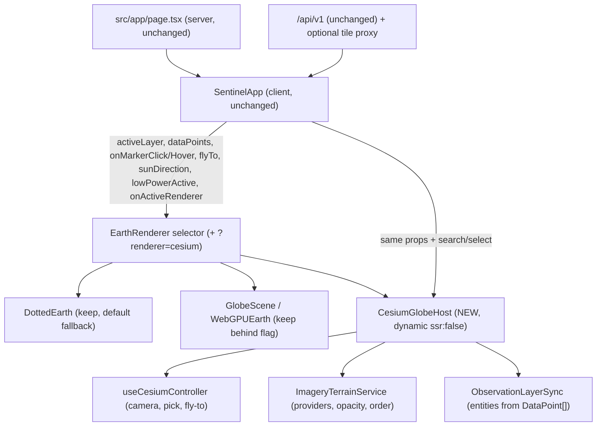
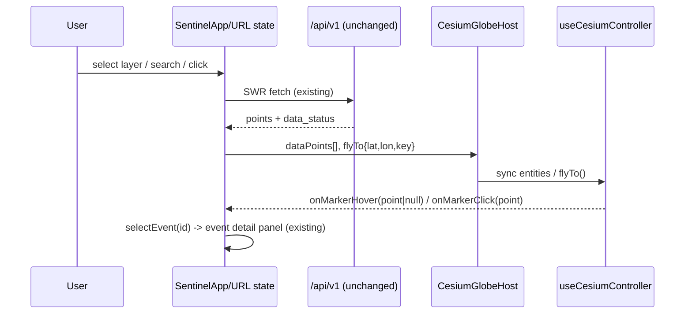
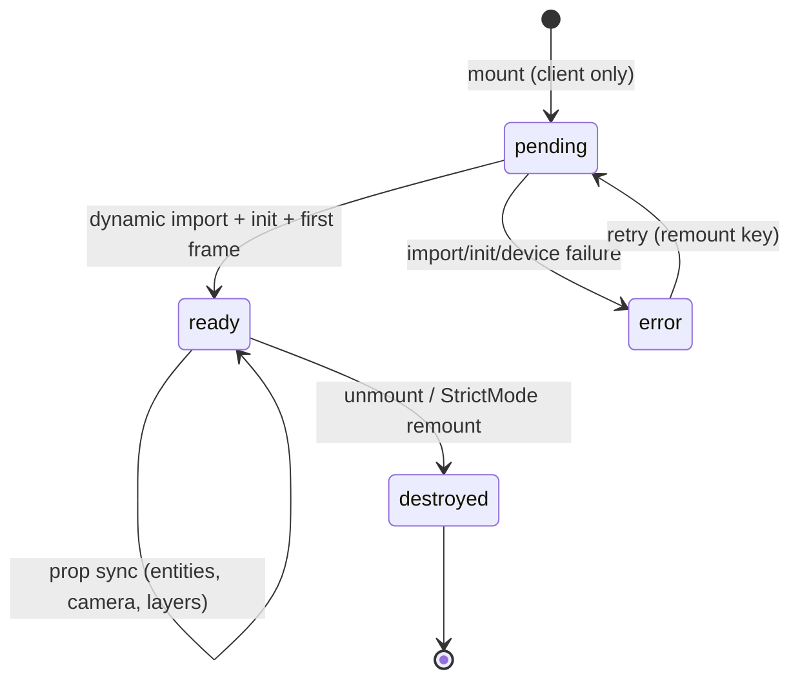

# Cesium Target Architecture (Phase 1 — proposal)

Status: **Recommended**. Nothing below is implemented. Paths follow existing
conventions (`src/components/globe/*`, `src/lib/*`, `src/types/*`).

## 1. Architecture overview



Design rule: the app never touches the Cesium `Viewer` object. It talks to the
host through the **existing Sentinel globe contract** (props in, callbacks out).
Only the controller and layer services touch Cesium APIs.

## 2. Component responsibilities

| Module (proposed path) | Responsibility |
|---|---|
| `globe/CesiumGlobeHost.tsx` | Render container div; dynamic-import Cesium on client; init viewer once; own loading/error veils; report `RendererInfo`; destroy on unmount. Only React–Cesium seam. |
| `globe/useCesiumController.ts` | Camera fly-to/home, coordinate picking, selection events, hover throttle. Holds viewer in a ref; exposes stable callbacks; never re-created per render. |
| `globe/cesiumImagery.ts` | Provider registry: GIBS WMTS (existing allow-list), ion imagery (opt-in), ellipsoid fallback; visibility, ordering, opacity, attribution, load/error status. Add/remove layers without recreating the viewer. |
| `globe/cesiumTerrain.ts` | Terrain selection: ellipsoid default; `CesiumTerrainProvider` (ion World Terrain, opt-in token) with graceful fallback. |
| `globe/cesiumObservations.ts` | Sync `DataPoint[]` → entities (`BillboardGraphics` or `PointPrimitiveCollection`), severity colors, show/hide by filter, dispose removed. |
| `globe/cesiumFootprints.ts` (later) | Sentinel polygons/rectangles from STAC geometry; click → scene detail. |
| `lib/geo-cesium.ts` | Pure converters: `{lat,lon} ↔ Cartesian3`, bbox → rectangle, magnitude → scale. Unit-tested, no Cesium import at module scope where avoidable (or engine-only `@cesium/engine` import in tests). |
| `types` (extend) | `ImageryLayerConfig`, `GeoSelection {kind: entity\|terrain\|ellipsoid, position, id?}`, provider status. Reuse existing `DataPoint`, `LayerId`, `data_status` vocab. |

## 3. Data flows



Layer switch never rebuilds the viewer: entity sync diffs by id; imagery
changes go through the provider registry.

## 4. State-management strategy

No new global store (**Recommended**). Keep: URL query as navigation/selection
source of truth (`lib/url-state.ts`), SWR as server-data cache, local state for
transient globe UI. The Cesium viewer instance lives in a host-local ref and is
**not** lifted into React state or context (prevents re-render storms). If
distant components need viewer readiness, expose a minimal `onActiveRenderer`
extension already in the contract — do not create a viewer context unless Phase 2
proves one necessary.

## 5. Viewer lifecycle (Strict-Mode safe)



Rules: init once per mount inside an effect with a `cancelled` flag (async import
resolving after unmount must no-op); `viewer.destroy()` on cleanup; screen-space
handlers removed before destroy; `Ion.defaultAccessToken` set from config before
any ion provider is constructed; error boundary + veil mirror the existing
`EarthRenderer` pattern. Never mount two full Earth renderers at once — the
selector guarantees one active branch.

## 6. Imagery and terrain abstractions

```ts
interface ImageryLayerConfig {
  id: string;                 // e.g. "gibs-truecolor", "ion-world-imagery"
  kind: "wmts" | "ion" | "url-template";
  url?: string;               // WMTS template (GIBS redirect base reuse)
  layer?: string;             // allow-list id, validated like the tile route
  opacity: number;            // 0..1
  visible: boolean;
  attribution: string;        // required credit
}
```

- Default: ellipsoid + GIBS true-color WMTS (no token, matches existing
  allow-list; reuse `buildTileUrl` server-side or construct client-side from the
  capabilities payload).
- Opt-in: ion World Imagery + Terrain via token (see security strategy).
- Every layer reports `loading → ready | error`; provider errors surface in the
  existing `DataStatusBanner` vocabulary, never as silent blanks.

## 7. Observation-layer architecture

Existing `DataPoint[]` is the single data contract (no duplication). Sync layer
maps: point → entity id (`point.id`), severity → billboard color/scale,
`lat/lon` → `Cartesian3.fromDegrees`. Filters apply before sync (severity,
bbox). Cap policy mirrors `MARKER_CAPACITY` (2000). Footprints (Phase 6+):
STAC polygon → `PolygonGraphics` clamped to terrain/ellipsoid; scene detail
fetched through existing event-detail patterns.

## 8. Geographic interaction contracts

| Interaction | Cesium primitive | Contract out |
|---|---|---|
| Click marker | `ScreenSpaceEventHandler LEFT_CLICK` + `pick` entity | `onMarkerClick(point)` |
| Hover marker | `MOUSE_MOVE` throttled (rAF) + `pick` | `onMarkerHover(point\|null)` |
| Click empty globe | `pickEllipsoid` (default) | coordinate → reverse path (`UNAVAILABLE` today; coordinate readout only) |
| Terrain-height click (later) | `pickPosition` (requires depth) | same, with height |
| Search fly-to | `camera.flyTo({destination: Cartesian3.fromDegrees(lon,lat,h), orientation})` | driven by existing `flyTo {lat,lon,key}` prop |
| Home/reset | `camera.flyTo` to `DEFAULT_HOME` | new header control (Phase 5) |

Reduced motion: instant `camera.setView` instead of `flyTo`; rotation off.

## 9. Next.js integration strategy

- Client Component + `next/dynamic(..., {ssr:false})` — identical to the
  existing 3D branches. Resium (if chosen) likewise mounts only under the
  dynamic boundary (Resium docs: SSR unsupported).
- `window.CESIUM_BASE_URL = "/cesium"` set in the client component before
  importing viewer code (Resium/Cesium official pattern).
- `widgets.css` imported inside the client-only chunk, never in the server
  graph (keeps initial CSS/JS budgets intact).
- Static assets: copy `Workers ThirdParty Assets Widgets` from
  `node_modules/cesium/Build/Cesium` to `public/cesium` at build time
  (CopyWebpackPlugin in `next.config.mjs` `webpack()` hook, or a prebuild
  script — decision in Phase 2 PoC). Never commit copied assets.
- CSP (enforcing later): extend to `worker-src 'self' blob:`,
  `img-src 'self' data: blob: <tile hosts>`, `connect-src 'self' <ion/tile
  hosts>`, `style-src 'self' 'unsafe-inline'` for widget CSS if needed.
  Start report-only and observe.

## 10. Asset and worker configuration strategy

Deterministic and repeatable: pinned `cesium` version → copy step keyed off
`node_modules` (not checked-in blobs) → `CESIUM_BASE_URL=/cesium` constant
shared by code and config → CI builds assets the same way (`npm ci` then
`build`). Dev (`next dev`) and prod (`next start` / Vercel) serve `public/cesium`
identically. Vercel output must include the copied dir — verify in Phase 2 PoC
(function + static export constraints do not apply; standard Next.js output).

## 11. Error-handling strategy

Mirror existing vocabulary: viewer init failure → error veil + fallback branch
(dotted) + dock status; provider failure → layer status line + keep previous
imagery; WebGL unavailable → dotted default (never blank). All async init paths
are cancellable; StrictMode double-mount must not leak viewers (assert via
unmount test with mocked viewer).

## 12. Testing strategy

Unit (pure, no WebGL): geo converters, layer-config validation, bbox math,
selection mapping. Component (mocked `cesium`/`resium` modules + jsdom):
loading veil, init error, layer visibility toggles, selection callbacks,
unmount disposal. Browser PoC (manual in Phase 2; automation only if a
framework is adopted in a later phase): asset loading, init, camera, picking,
layer switch, resize, prod build. Regression: full existing suite before/after
each phase; API contracts frozen.

## 13. Security boundaries

Browser may hold only: public ion token (restricted, referrer/asset-scoped) or
no token at all on the default path. FIRMS/AirNow keys stay server-side
unchanged. Tile URLs validated against allow-lists (extend `imagery.ts`
discipline to any new provider). No credentials in logs (`redact.ts` applies to
any new server tile-proxy).
